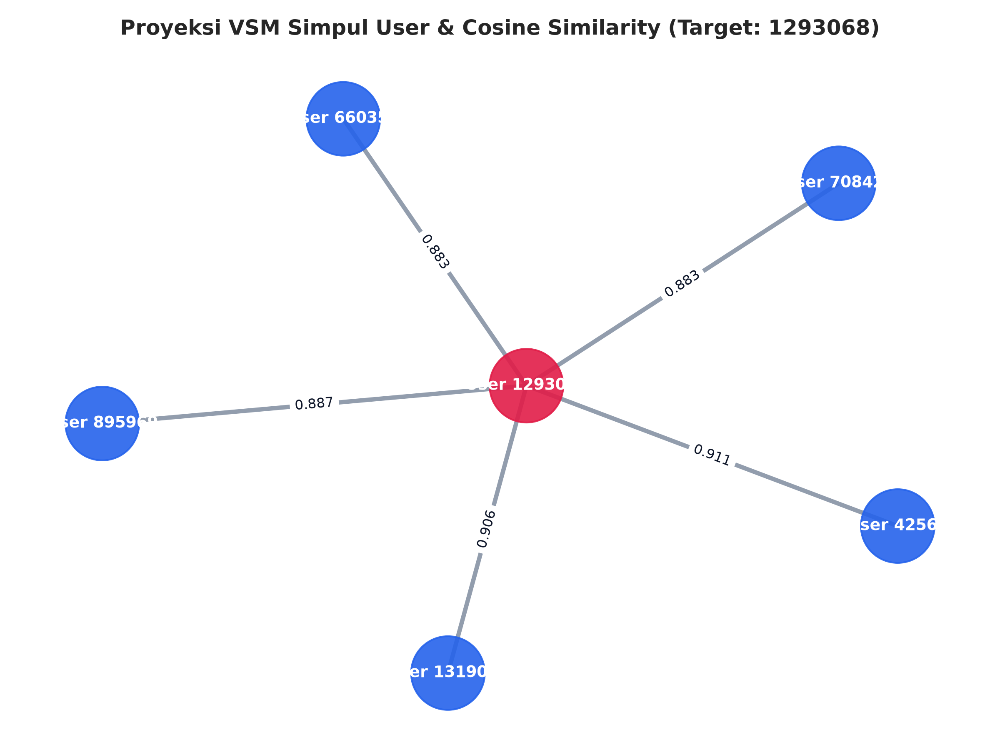
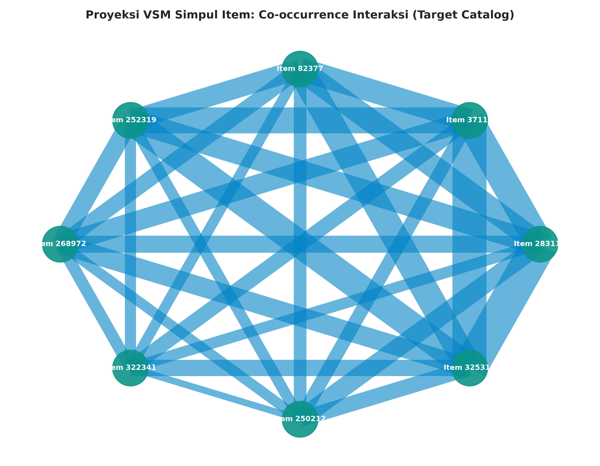
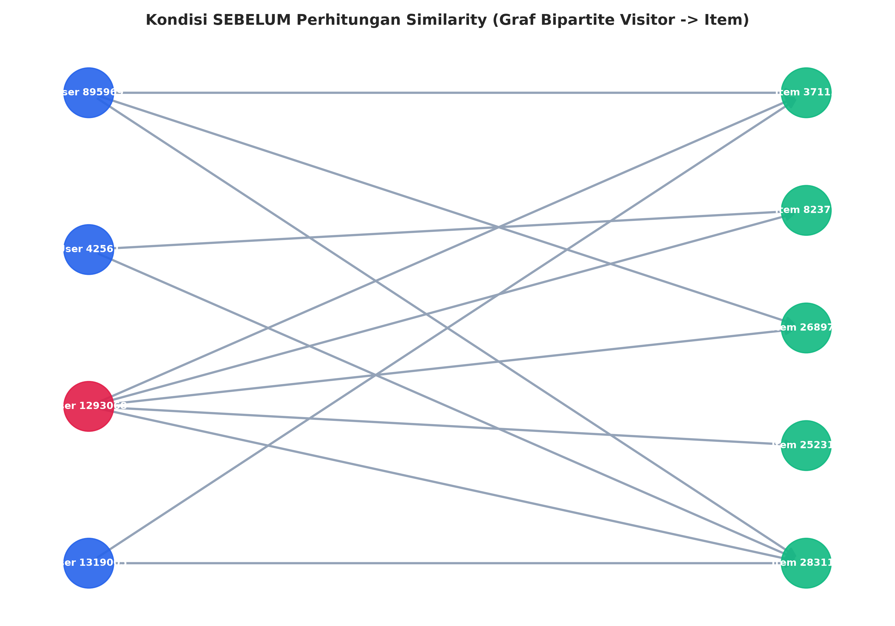
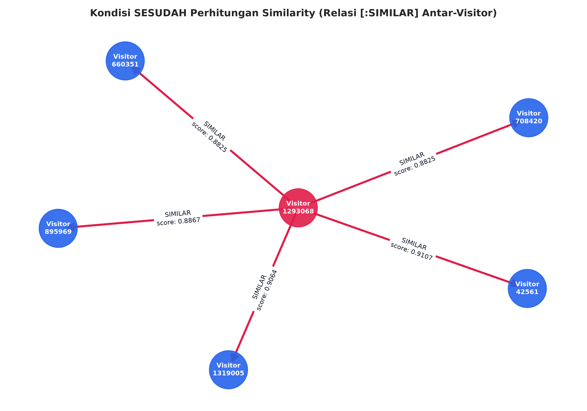
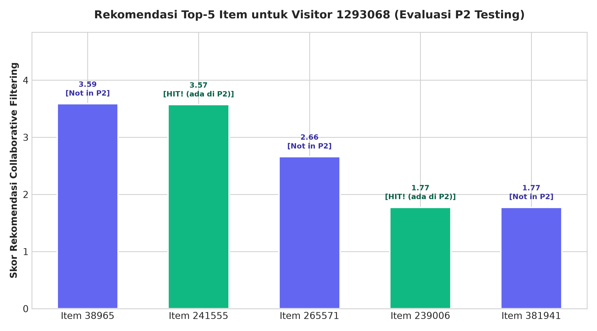

# Ujian Tengah Semester (UTS) Graf Sains Data
## Analisis Graf Bipartite, Vector Space Modelling (VSM), dan Sistem Rekomendasi Collaborative Filtering KNN pada Dataset E-Commerce RetailRocket Menggunakan Neo4J dan Python

---

## 👤 Identitas Mahasiswa

| Atribut | Detail Informasi |
| :--- | :--- |
| **Nama Lengkap** | **MOCH. AKBAR HANAFI** |
| **Nomor Induk Mahasiswa (NIM)** | **23031554018** |
| **No. Urut Presensi** | **3** |
| **Kelas** | **GSD 2023E** |
| **Program Studi** | S1 Sains Data |
| **Institusi** | Universitas Negeri Surabaya — FMIPA |
| **Mata Kuliah** | Graf Sains Data (3 SKS) |
| **Dosen Pengampu** | Tim Dosen Graf Sains Data |
| **Fold Training (P1)** | `2015-05-03 00:00:00 UTC` s/d `2015-07-22 23:59:59 UTC` (`1430611200000` s/d `1437609599999` ms) |
| **Fold Testing (P2)** | `2015-07-23 00:00:00 UTC` s/d `2015-08-12 23:59:59 UTC` (`1437609600000` s/d `1439423999999` ms) |

---

## 📋 Kriteria Keberterimaan (Acceptance Criteria)

- [x] **AC 1: Lingkungan (Environment) & Setup Neo4j**
  - Virtual environment Python (`myvenv`) terisolasi dan dependensi lengkap (`requirements.txt`) terpasang.
  - Neo4J server aktif (via Docker Container) terhubung pada `bolt://localhost:7687` menggunakan driver Python resmi.
- [x] **AC 2: Checkpoint Tugas Pendahuluan**
  - Menjawab 3 pertanyaan konsep: (1) Nama database (`neo4j`), (2) Akses multi-database Cypher (`USE <db>`, `driver.session(database=...)`), (3) Jenis graf pertemanan (directed graph / graf berarah).
  - Skrip pengujian operasi graf (`add_friend`, `print_friends`) dan Cypher Total Reset (`MATCH (n) DETACH DELETE n;`).
- [x] **AC 3: Wrangling & Filter Timestamp Sesuai Identitas Mahasiswa**
  - Pemfilteran timestamp interaksi pada berkas `events.csv` berdasarkan Unix Epoch milliseconds:
    - Fold Training (P1): `1430611200000` s/d `1437609599999` (1.681.206 baris)
    - Fold Testing (P2): `1437609600000` s/d `1439423999999` (433.774 baris)
  - Penyimpanan berkas CSV mandiri di direktori `data/` (`events_p1_train.csv`, `events_p2_test.csv`, `events_subgraph.csv`).
- [x] **AC 4: Impor & Analisis Komposisi Subgraph (Soal 2.1.3)**
  - Mengimpor komunitas interaksi subgraph aktif ke Neo4j via mekanisme batch import dengan unique constraints pada `visitorId` dan `itemId`.
  - Menguraikan komposisi simpul (`Visitor`: 374, `Item`: 9.137) dan relasi (`VIEWED`: 23.349, `ADDED_TO_CART`: 1.482, `BOUGHT`: 1.055) via Python API dan kueri Cypher.
- [x] **AC 5: Vector Space Modelling (VSM) User & Item (Soal 2.1.4 & 2.1.5)**
  - VSM Simpul User: Matriks $374 \times 9.137$, sparsity 99.57%, visualisasi graf proyeksi User menggunakan NetworkX.
  - VSM Simpul Item: Matriks $9.137 \times 374$, sparsity 99.57%, visualisasi graf proyeksi Item (co-occurrence) menggunakan NetworkX.
- [x] **AC 6: Evaluasi Komparatif Proyeksi User vs Item (Soal 2.1.6)**
  - Analisis mendalam efektivitas vs efisiensi komputasi ($\mathcal{O}(|U|^2 \cdot |I|)$ vs $\mathcal{O}(|I|^2 \cdot |U|)$). Proyeksi User terbukti ~24.4x lebih efisien secara komputasi dan memori serta langsung memodelkan preferensi tetangga untuk rekomendasi KNN.
- [x] **AC 7: Perhitungan Similarity & Update Graf (Soal 2.1.7 & 2.1.8)**
  - Menghitung Cosine Similarity antar-pengunjung dengan target acuan **Visitor `1293068`**.
  - Mengambil Top 5 record similarity tertinggi via Cypher.
  - Menuliskan kembali relasi `[:SIMILAR {score: ...}]` ke Neo4j dan memverifikasi hasilnya.
  - Membandingkan kondisi graf SEBELUM (bipartite) dan SESUDAH (homogen terproyeksi) via Cypher dan visualisasi graf NetworkX.
- [x] **AC 8: Rekomendasi Collaborative Filtering KNN & Evaluasi Offline (Soal 2.2.1 & 2.2.2)**
  - Pemilihan user target secara acak yang dapat direproduksi (`np.random.seed(17)`).
  - Algoritma KNN ($k=5$) menghasilkan Top-3 item preferensi tertinggi yang belum pernah diakses target user.
  - Evaluasi offline terhadap Fold Testing (P2):
    - **Hit@5 = 1** (Ditemukan 2 hit pada Top 5: Item `241555` di Rank 2 dan Item `239006` di Rank 4).
    - **NDCG@5 = 0.3601** (DCG@5 = 1.0616, IDCG@5 = 2.9485).

---

## 📂 Struktur Repositori

```text
UTS GRAF/
├── UTS_GSD_23031554018_MOCH_AKBAR_HANAFI.ipynb  # Jupyter Notebook Utama (Terisi Output Lengkap)
├── import_neo4j.py                              # Skrip Impor Batch Data ke Neo4J (CLI Argparse)
├── vsm_similarity_analytics.py                  # Skrip Pipeline Analisis VSM, Similarity, & KNN
├── build_notebook.py                            # Skrip Generator Notebook
├── requirements.txt                             # Daftar Dependensi Python
├── README.md                                    # Dokumentasi Lengkap Proyek
├── .gitignore                                   # Konfigurasi Pengabaian Git
├── data/
│   ├── events_p1_train.csv                      # Fold Training P1 Hasil Filter (1.68M baris)
│   ├── events_p2_test.csv                       # Fold Testing P2 Hasil Filter (433K baris)
│   └── events_subgraph.csv                      # Subgraph Komunitas Interaksi (25.8K baris)
└── plots/
    ├── vsm_user_projection.png                  # Plot Graf Proyeksi Simpul User
    ├── vsm_item_projection.png                  # Plot Graf Proyeksi Simpul Item
    ├── graph_before_similarity.png              # Plot Kondisi Sebelum Perhitungan Similarity
    ├── graph_after_similarity.png               # Plot Kondisi Sesudah Perhitungan Similarity
    └── knn_recommendations.png                  # Plot Hasil Evaluasi Rekomendasi KNN Top-5
```

---

## 🚀 Panduan Menjalankan Proyek

### 1. Setup Virtual Environment
```bash
# Membuat virtual environment
uv venv myvenv --python 3.12
source myvenv/bin/activate

# Menginstal dependensi
uv pip install -r requirements.txt
```

### 2. Memastikan Neo4J Aktif
```bash
# Menjalankan container Neo4J (Docker)
docker start neo4j

# Atau membuat container baru jika belum ada:
# docker run -d --name neo4j -p 7474:7474 -p 7687:7687 -e NEO4J_AUTH=neo4j/password123 neo4j:latest
```

### 3. Mengimpor Data ke Neo4J
```bash
python import_neo4j.py --reset --source data/events_subgraph.csv
```

### 4. Menjalankan Analisis VSM, Similarity, dan Rekomendasi KNN
```bash
python vsm_similarity_analytics.py
```

### 5. Membuka dan Mengeksekusi Jupyter Notebook
```bash
jupyter notebook UTS_GSD_23031554018_MOCH_AKBAR_HANAFI.ipynb
```

---

## 📊 Ringkasan Hasil Analisis dan Evaluasi

### 1. Komposisi Subgraph di Neo4J
- **Simpul Visitor:** 374 node
- **Simpul Item:** 9.137 node
- **Relasi `[:VIEWED]`:** 23.349 relasi
- **Relasi `[:ADDED_TO_CART]`:** 1.482 relasi
- **Relasi `[:BOUGHT]`:** 1.055 relasi
- **Total Relasi Interaksi:** 25.886 relasi

### 2. Top-5 Rekor Similarity Tertinggi untuk Record Acuan (Visitor `1293068`)
1. **Visitor `42561`** : Cosine Similarity = `0.9107`
2. **Visitor `1319005`** : Cosine Similarity = `0.9064`
3. **Visitor `895969`** : Cosine Similarity = `0.8867`
4. **Visitor `708420`** : Cosine Similarity = `0.8825`
5. **Visitor `660351`** : Cosine Similarity = `0.8825`

### 3. Top-3 Item Rekomendasi Collaborative Filtering KNN ($k=5$)
1. **Item ID `38965`** : Skor Prediksi Preferensi = `3.5862`
2. **Item ID `241555`** : Skor Prediksi Preferensi = `3.5709` (**HIT!** Diakses user pada Fold Testing P2)
3. **Item ID `265571`** : Skor Prediksi Preferensi = `2.6602`

### 4. Hasil Evaluasi Offline (Fold Testing P2)
- **Hit@5:** `1` (Berhasil mengenai 2 item aktual pada P2 dari 5 rekomendasi)
- **NDCG@5:** `0.3601` ($DCG@5 = 1.0616$, $IDCG@5 = 2.9485$)

---

## 🖼️ Galeri Visualisasi Graf

| Visualisasi | Keterangan |
| :--- | :--- |
|  | **Proyeksi VSM Simpul User:** Menunjukkan target user (merah) terhubung dengan 5 tetangga terdekatnya beserta bobot Cosine Similarity. |
|  | **Proyeksi VSM Simpul Item:** Menunjukkan jaringan co-occurrence antar-produk e-commerce berdasarkan pola co-viewing pengguna. |
|  | **Kondisi SEBELUM:** Graf bipartite murni di mana Visitor hanya terhubung ke Item melalui relasi interaksi. |
|  | **Kondisi SESUDAH:** Graf homogen diperkaya dengan relasi langsung `[:SIMILAR]` antar-Visitor. |
|  | **Evaluasi Rekomendasi:** Peringkat Top-5 item rekomendasi yang menyoroti keberhasilan Hit pada Fold Testing P2. |

---

## 📌 Pengumpulan Tugas
- Repositori GitHub ini memuat seluruh kode program, dokumentasi notebook `.ipynb` yang terisi output lengkap, visualisasi, dan dataset hasil filter.
- Tautan repositori GitHub dikumpulkan pada portal LMS SiDia sesuai batas waktu yang ditentukan.
